# 5. Running a journey

Specification 0.1. Written from proposals [0009](../proposals/0009-running-a-workflow.md) as amended by [0032](../proposals/0032-configuration-errors.md), [0012](../proposals/0012-local-executor.md), [0040](../proposals/0040-events-facts-and-decisions.md), [0042](../proposals/0042-configuration-errors-before-the-journey.md), [0049](../proposals/0049-custom-code-that-throws.md), [0054](../proposals/0054-how-custom-code-fails.md), [0056](../proposals/0056-data-bag-values.md), [0058](../proposals/0058-building-policies.md), [0061](../proposals/0061-instance-carries-journey-id-and-reporters.md), [0062](../proposals/0062-workflow-descriptors.md), [0063](../proposals/0063-dispatcher-factory.md), [0065](../proposals/0065-business-result.md), [0085](../proposals/0085-aborted-result-has-no-data.md), [0083](../proposals/0083-what-failures-carry.md), [0024](../proposals/0024-abnormal-termination-retriable.md), [0095](../proposals/0095-services-provided-to-steps.md), [0102](../proposals/0102-global-metadata.md), [0104](../proposals/0104-service-implementation-on-events.md), [0106](../proposals/0106-retry-budget-alone.md), [0113](../proposals/0113-value-conversions.md), [0121](../proposals/0121-read-only-copies.md) and [0122](../proposals/0122-unexpected-results.md), and from proposal [0003](../proposals/0003-rescue-steps.md). Its suggested names come from proposal [0111](../proposals/0111-suggested-application-interface.md).

How an executor runs a workflow instance: the instance and its data, journey IDs, the scan, step statuses, retries, the result, and the executor itself. What the hooks called along the way may decide is defined in chapter 6; where this chapter says "by default", a hook may change it there.

## 5.1 The workflow instance

1. **One workflow instance per journey.** The developer's own code creates a workflow instance from a workflow for each journey and hands it to an executor. Creating it produces, in this order, its initial data, its journey ID (5.2) and its reporters, which MAY receive the journey ID. A failure while creating the instance, including in producing the ID or making a reporter, happens before the executor is involved, and the specification defines nothing more about it, except a journey ID that is not a string or is empty (5.2 point 4), and a value conversion or a copy of initial data or initial global metadata that fails, which points 2 and 3 cover.
2. **Initial data.** The instance MAY be created with initial data, and MAY obtain more while it is created. Whatever it holds when handed to the executor MUST be the initial content of the data bag. Keys are strings, and every value MUST be a value (chapter 4, 4.6); initial data that is not a value, including a key whose value conversion or copy fails (5.10), is refused by `run`, listing each key concerned (chapter 3, 3.7).
3. **Initial global metadata.** The instance MAY be created with initial global metadata (chapter 2, 2.11). Keys are strings, every value MUST be a value, and a key set twice while the instance is created keeps its last value. The key `journey_id` is reserved for the journey ID. Initial global metadata that is not a value, including a key whose value conversion or copy fails (5.10), or that sets `journey_id`, is refused by `run`, listing each key concerned (chapter 3, 3.7).
4. **The instance holds the journey's state.** The data bag and all other journey state belong to the instance. The instance provides its workflow descriptor (chapter 3, 3.1), the roles, its journey ID, its reporters, its data and its initial global metadata; the executor builds every step and policy from the descriptors, and an instance never builds, holds or orders them.
5. **An instance runs at most one journey.** Handing an executor an instance that has already run, or is running, MUST be refused as a configuration error.

## 5.2 Journey IDs

1. In tier 1 a journey has exactly one run, so it has one ID, the **journey ID**.
2. **The instance provides its journey ID.** It is produced while the instance is created, and the executor MUST use it; the executor never produces an ID. How it is produced is the workflow's choice: implementations MUST offer a default that produces a UUID v4, used unless the workflow provides its own way, which MAY derive the ID from the instance's data.
3. The caller does not pass an ID to `run`.
4. **A journey ID is a string that is not empty.** Producing anything else, such as a null-like value, a number, a promise or future, any other object, or an empty string, MUST make creating the instance fail, as the language's own error: there is no journey and no event (5.1 point 1).

## 5.3 The data bag

1. Each journey has one data bag, held by the workflow instance.
2. It starts with the initial data. `journey_started` MUST list the initial keys and MUST NOT carry their values.
3. It receives committed contributions, from steps (chapter 4) and hooks (chapter 6), and is read by input resolution and service providers' requests (chapter 4) and by hooks' requests (chapter 6). Nothing else changes it.

## 5.4 Step statuses

1. Every step has a status in the journey:

   | Status | Meaning |
   |---|---|
   | `NotExecuted` | the step has not run yet, or never ran |
   | `Executing` | an attempt of the step is running |
   | `MustRetry` | the last attempt failed and another will be made |
   | `Rescuing` | the last attempt failed and was handed to the step's rescue step, which has not succeeded yet (chapter 7) |
   | `Succeeded` | the step succeeded |
   | `Failed` | the step failed and will not be tried again |
   | `Skipped` | the step skipped itself |
   | `Aborted` | the journey was aborted while the step was `Executing`, `MustRetry` or `Rescuing` |

2. Every step starts as `NotExecuted`. After an abort, the steps after the aborted one remain `NotExecuted`, except the step a rescue step rescues (chapter 7, 7.5). A rescue step starts as `NotExecuted` when it is inserted (chapter 7).
3. **Run-once.** A step that ended as `Succeeded`, `Failed` or `Skipped` MUST NOT run again in the journey.

## 5.5 Order and the scan

1. **Strict order.** Steps MUST run in the order of their step descriptors. Nothing can reorder steps, skip a step other than the step itself, or jump between steps. The one step the executor adds is a rescue step, inserted just before the step it rescues (chapter 7).
2. **The scan.** The executor repeatedly considers the first step that is not finished:
   - a `Succeeded` or `Skipped` step is passed over;
   - a `NotExecuted`, `MustRetry` or `Rescuing` step is built and run (chapter 4), as its next attempt;
   - a `Failed` step ends the journey as failed;
   - when no step is left, the journey succeeds.

```mermaid
stateDiagram-v2
  accTitle: Step statuses in tier 1
  accDescr: A step starts as NotExecuted and becomes Executing when an attempt starts. From Executing it becomes Succeeded, Skipped, Failed, MustRetry, Rescuing or Aborted. From MustRetry or Rescuing it becomes Executing again for the next attempt, or Aborted if the journey is aborted first; a step whose rescue step failed stays Rescuing, unless the journey is aborted afterwards.
  [*] --> NotExecuted
  NotExecuted --> Executing: attempt starts
  MustRetry --> Executing: next attempt starts
  Executing --> Succeeded: success
  Executing --> Skipped: skipped
  Executing --> MustRetry: retry allowed
  Executing --> Failed: no retry
  Executing --> Aborted: journey aborted
  MustRetry --> Aborted: journey aborted
  Executing --> Rescuing: rescue step inserted
  Rescuing --> Executing: rescue succeeded, next attempt starts
  Rescuing --> Aborted: journey aborted
```

The diagram shows these transitions:

1. A step starts as `NotExecuted`, and becomes `Executing` when its first attempt starts.
2. From `Executing`, it becomes `Succeeded` on success, `Skipped` on a skip, `MustRetry` when a retry is allowed (5.6), `Failed` when no retry is allowed, and `Aborted` when the journey is aborted while it is executing.
3. From `MustRetry`, it becomes `Executing` again when the next attempt starts, or `Aborted` when the journey is aborted before that attempt starts.
4. From `Executing`, it becomes `Rescuing` when its rescue step is inserted, and from `Rescuing` it becomes `Executing` again when its next attempt starts, after the rescue step succeeded, or `Aborted` when the journey is aborted before that (chapter 7). A rescued step whose rescue step failed stays `Rescuing`, unless the journey is aborted afterwards (chapter 7, 7.5).
5. `Succeeded`, `Skipped`, `Failed` and `Aborted` are final.

## 5.6 Attempts and retries

1. **Attempts are counted from 1.** The first execution of a step is attempt 1. A step with a retry budget of N MUST be attempted at most N + 1 times, plus one attempt after its rescue step succeeded (chapter 7).
2. **What is retried.** A failure, or an abnormal termination while the step descriptor's `retry on abnormal termination` is on, MUST put the step in `MustRetry` while its retry budget allows another attempt, unless a hook returns `FailWorkflow` (chapter 6). Both use the same budget. The decision is recorded by `step_retrying` (chapter 2). Nothing a step reports asks for a retry or prevents one.
3. **When a budget greater than 0 is spent**, the step becomes `Failed`, and its failure hook is called with the cause `retries exhausted`. Whenever a step becomes `Failed`, the decision is recorded by `step_given_up`, with its cause (chapter 2).
4. **What is not retried.** With a retry budget of 0, a failure makes the step `Failed` at once with the cause `failure`, and an abnormal termination with the cause `abnormal termination`. With `retry on abnormal termination` off, an abnormal termination makes the step `Failed` at once with the cause `abnormal termination`, whatever its budget.
5. **A retry happens immediately.** The executor MUST NOT wait between attempts. A step that needs to wait before reporting a failure does so itself.
6. **A step with a rescue step** has a retry budget of 0, and on its first failed attempt, whatever the outcome or the `retry on abnormal termination` setting, it is rescued instead of being given up, unless `on step abnormal termination` returns `FailWorkflow` (chapter 7).

## 5.7 How a journey ends

1. **Succeeded:** every step ended as `Succeeded` or `Skipped`, or a hook returned `FinishWorkflow` (chapter 6). Steps that did not run remain `NotExecuted`.
2. **Failed:** a step ended as `Failed`, or a hook returned `FailWorkflow` (chapter 6). Later steps do not run, and remain `NotExecuted`, except a step whose rescue step failed, which remains `Rescuing` (chapter 7).
3. **Aborted:** something illegal happened. The step during which it happened, if any, becomes `Aborted` if it was `Executing` or `MustRetry`, and so does a step that was `Rescuing` (chapter 7, 7.5); a step whose status was already final keeps it. A status changes when the step's outcome or decision is final, before the event that records it is delivered (chapter 2, 2.6). Later steps remain `NotExecuted`, except the step a rescue step rescues (chapter 7, 7.5), and no hook runs afterwards. An abort means something illegal happened, typically code that did not handle an error as it should: an aborted journey has no business outcome, and it MUST NOT be resumed or continued, by any executor, in this tier or any later one. The abort reasons are:

   | Abort reason | When | Defined in |
   |---|---|---|
   | `step could not be built` | a step's constructor, the input adapter resolving one of its inputs, or the service provider for one of its services, failed, or the adapter supplied something that is not a value, or the provider returned nothing | chapter 4 |
   | `policy could not be built` | a step policy failed while being built for an attempt | chapter 6 |
   | `required data missing` | a required request has no value | chapters 4, 6 and 7 |
   | `wrong type` | a requested value has the wrong type | chapters 4, 6 and 7 |
   | `invalid lifecycle` | a hook returned a lifecycle it may not return | chapter 6 |
   | `not a value` | a step, hook or service provider contributed, emitted, set as global metadata, gave in a reason's details, or supplied with an instance something that is not a value | chapters 2 and 4 |
   | `hook failed` | a hook, or a role operation it called, failed | chapter 6 |
   | `reporter failed` | a reporter, or a dispatcher while dispatching, failed | chapter 2 |
   | `rescue skipped` | a rescue step reported Skipped | chapter 7 |
   | `reserved metadata key` | a step, hook or service provider set global metadata under the key `journey_id` | chapter 2 |
   | `unexpected result` | custom code returned something that is not one of the results its call can return | 5.10 |

   All but `hook failed` and `reporter failed` are configuration errors that can only show up during a journey. `hook failed` and `reporter failed` are faults while running, with the same rules for the event stream.

## 5.8 The result

1. **The result is a business outcome.** It MUST carry:
   1. the **journey ID**;
   2. the **final status**, with what explains it:
      - **succeeded**;
      - **failed**, with its **cause**, the **reason** when a step or hook gave one, and the **error** when an error ended the last attempt:

        | Cause | Reason | Error |
        |---|---|---|
        | `failure` | the step's reason | none |
        | `retries exhausted` | the reason of the last attempt, if it reported a failure | the error of the last attempt, if it ended in an abnormal termination |
        | `abnormal termination` | none | the error |
        | `FailWorkflow` | the reason the hook gave | none |

      - **aborted**, with the abort reason and its details, and the **error** when custom code caused the abort by failing (5.10);
   3. for a journey that succeeded or failed, the **data bag** as it stood at the end: the initial data plus every committed contribution. The data bag is the journey's output. An aborted journey's result carries no data bag: an abort is a fault, and the data bag may stand halfway through a change. When a journey is aborted while contributions are being committed, whether the remaining ones are committed is not observable, and is left to the implementation.
2. **How an error is carried.** Wherever the result carries an error, it MUST carry its message, and SHOULD carry the error itself, so that the caller can inspect it, in every language that can hold any error in one value. An error's message is the language's own text for it; when the error comes from a failure scripted with a message, as conformance does, it is exactly that text.
3. **Content, not shape.** This section lists what a result carries. Whether a language represents it with a tagged union, optional fields or anything else is its own choice.
4. **Not in the result:** each step's status and attempt count, and the name of the step that failed or during which the journey was aborted. They are in the event stream: `attempt_started`, the outcome facts and the decisions give every step's status and attempt count, an attempt counting from its `attempt_started`, and `journey_failed` and `journey_aborted` name the step. Implementations MAY offer a way to derive step statuses from a journey's event stream, but it is not part of the result.

## 5.9 The executor

1. **Executors differ in capability, never in meaning.** A lifecycle, an outcome, a status or an event MUST mean the same under every executor.
2. **Executors are not coupled to workflows.** An executor MUST NOT depend on how a workflow, its descriptor or its instance was produced: by a builder, by macros or annotations, or by hand. Any executor of a language MUST be able to run any instance of that language. How this abstraction is expressed is each language's choice, recorded in its tech spec; 5.13 suggests what an instance usually provides.
3. **The local executor** runs a journey in process, with no persistence: a journey lives only as long as the call that runs it.
4. **`run(workflow instance)`** MUST run exactly one journey and return its result. It MUST NOT throw for anything that happens inside the journey: failures and aborts are in the result. An asynchronous executor returns the same result asynchronously. A workflow refused at admission (chapter 3), when it is built or because the executor does not accept a mode, and a failure before the journey starts (5.10), are reported to the developer as a refusal instead: no journey and no event. An unrecoverable failure is not a result either (5.10).
5. **Stateless between journeys.** When `run` returns, nothing of that journey MUST remain in the executor: no data, no statuses, no reporters. An executor MAY run many journeys, one after another.
6. **One journey at a time.** An executor MUST NOT run two journeys concurrently. A call to `run` while another journey is running on the same executor MUST be refused before anything starts, with no journey and no events. Implementations SHOULD make this impossible to write where their language allows it. Parallelism comes from creating several executors.
7. **One dispatcher per journey**, created by the executor's dispatcher factory, as chapter 2 defines.

## 5.10 How custom code fails

1. **All custom code fails the same way:** by throwing, or by returning an error through its signature, wherever this specification does not give that error another meaning. Both are **recoverable failures**, and implementations MUST catch every one of them. What differs is the consequence: a step can recover, so its failure is an abnormal termination, which its descriptor may retry; hooks, role operations, reporters and dispatchers cannot report an error and carry on, so their failure aborts the journey. Returning something the call cannot return is neither: it is an unexpected result (point 7).
2. **Nothing custom code throws or returns as an error MAY escape `run`.** In tier 1, the executor calls custom code at exactly these points, with these outcomes:

   | Custom code | When it fails |
   |---|---|
   | the dispatcher factory, or the dispatcher while the journey's reporters are added | a refusal: no journey and no event |
   | a reporter, or the dispatcher, while the global metadata set before the journey starts is passed on | a refusal: no journey and no event (chapter 2, 2.11) |
   | a workflow policy, while it is built | a refusal: no journey and no event |
   | a step policy, while it is built for an attempt | the journey is aborted with `policy could not be built` (chapter 6) |
   | a step's constructor, a rescue step's included, the input adapter for one of its inputs, or the service provider for one of its services | the journey is aborted with `step could not be built` (chapter 4) |
   | a value conversion (chapter 1, 1.3), while a request reads a value: a step's input, a hook's or rescue step's request, an input adapter's or service provider's request, or a read through an input adapter's access to the data bag | the value is of the wrong type: the journey is aborted with `wrong type`, naming whom chapters 4, 6 and 7 name; for a read through an input adapter's access, the adapter is told the value is of another type, and nothing is emitted (chapter 4, 4.2 point 8) |
   | a value conversion, while an object is captured as a value: contributed, emitted as event data, set as global metadata, given in a reason's details, or supplied by an input adapter or by a service provider with an instance | it is not a value: the journey is aborted with `not a value`, or with `step could not be built` for an input adapter's supply, naming whom chapters 2, 4 and 6 name; for initial data or initial global metadata, a refusal listing the key (chapter 3, 3.7) |
   | a copy (chapter 4, 4.7), while a request, or a read through an input adapter's access to the data bag, reads a value | the value is of the wrong type for that request, with the outcomes of a value conversion that fails while a request reads a value, including, for a read through an input adapter's access, that the adapter is told the value is of another type and nothing is emitted (chapter 4, 4.2 point 8) |
   | a copy (chapter 4, 4.7), while an object is captured as a value | it is not a value, with the outcomes of a value conversion that fails while an object is captured, including, for initial data or initial global metadata, a refusal listing the key (chapter 3, 3.7) |
   | a running step, a rescue step included | an abnormal termination of the attempt; the journey is not aborted (chapter 4, chapter 7) |
   | a hook, including a role operation the hook calls | the journey is aborted with `hook failed` (chapter 6) |
   | a reporter, or a dispatcher while dispatching, on any event except `journey_aborted`, or on an entry of global metadata set while the journey runs | the journey is aborted with `reporter failed` (chapter 2) |
   | a reporter, or a dispatcher, while `journey_aborted` is being delivered | ignored: the first abort reason stands and no further event is emitted (chapter 2) |

3. **The list is exhaustive for tier 1.** A later proposal that adds a call into custom code adds it here, with its outcome. A value conversion is listed however it fails: by throwing, by returning an error or, while a value is read, by reporting that the value does not match. A conversion of initial data or initial global metadata is listed wherever a language makes it, even while the instance is created; one the application calls itself outside the journey, such as when reading the result's data bag, is not. A copy is listed however it fails, by throwing or by returning an error, and wherever a language makes it, as for a conversion. Producing the journey ID and making the reporters are not in the list: the executor does not make them (5.1).
4. **The error travels with its consequence.** When custom code fails and the journey is aborted, the abort carries that error: in `journey_aborted`, as its message, and in the result, as 5.8 point 2 says. This covers `hook failed`, `reporter failed` (for a reporter, or a dispatcher while dispatching), and `step could not be built` and `policy could not be built` when a constructor, an input adapter, a service provider or a policy failed. An abort that no error caused, such as `required data missing`, `wrong type`, `not a value`, or `step could not be built` because something supplied is not a value or a service provider returned nothing, carries no error, and neither does `unexpected result`, which no failure caused; it SHOULD carry a message saying what was returned (point 7). A value conversion that fails causes one of these: one that reports that a value does not match has no error to carry, and when one throws or returns an error, the abort MAY carry that error all the same, as a diagnostic that changes neither the abort reason nor its details. A refusal caused by failing custom code carries that error, with its message, as the result does; a refusal of initial data or initial global metadata whose value conversion failed MAY carry it. The same holds for a copy that fails by throwing or by returning an error: the abort or the refusal MAY carry that error, as a diagnostic.
5. **Unrecoverable failures are outside the model.** In a language that separates unrecoverable failures from recoverable ones, as the language defines them (for example a panic in Rust, or an `Error` such as `OutOfMemoryError` on the JVM), an unrecoverable failure is not a recoverable failure. The journey stops as if the process had crashed: no further event is emitted, so the stream may end without `journey_succeeded`, `journey_failed` or `journey_aborted`, and `run` produces no result. Implementations MUST NOT catch it in order to continue the journey or turn it into an outcome; it propagates to whoever called `run`, as the language defines.
6. **Two shapes of call.** Every call into custom code has one of two shapes, and each language's tech spec MUST say, for every call, which shape it has and how the language expresses it:
   1. **Void:** a call whose result is always nothing: a reporter, a dispatcher while it adds reporters or delivers an event, a role operation, and, in tier 1, a workflow hook. The executor MUST NOT read what a void call returns: whatever it returns, where the language lets it return anything, is ignored. A void call MUST NOT be given a result type that stands for nothing, such as an empty optional; it is void in the language's own terms.
   2. **With a result:** every other call: a step's run, a rescue step's, a step hook, the constructor of a step, a rescue step or a policy, the dispatcher factory, an input adapter, a service provider and a value conversion. Where this specification lets such a call return nothing, as for a step hook keeping the default (chapter 6, 6.3 point 1), an input adapter that does not supply its input (chapter 4, 4.2) and a service provider that returns nothing (chapter 4, 4.9 point 6.2), the language MUST express nothing by one explicit form of its own, such as an enumeration's variant or an empty optional, which its tech spec names. A null-like value, such as `null` in Java, or `null` or `undefined` in JavaScript, is never that form.
7. **An unexpected result.** A call with a result that returns something that is not one of the results this specification defines for it returns an **unexpected result**. That includes a null-like value where nothing is allowed, a result of the right kind but malformed, such as a failure without a code or an outcome that is none of the three, and something that looks like a lifecycle but is not one of tier 1's. A null-like value and the value null are kept apart: where a language uses a null-like value as its form of the value null (chapter 1, 1.3), as JavaScript does with `null`, a call whose result is a value, such as an input adapter, returns the value null by returning it, and that value is checked against the type asked for like any other, so for an input of type integer it is `wrong type`; a null-like value that is neither the language's form of nothing nor its form of the value null, such as `undefined` in JavaScript, is an unexpected result, while anything else that is not a value keeps the meaning chapter 4, 4.2 point 3 gives it. A call whose result is never a value, such as a step's run, a hook, a constructor, the dispatcher factory or a service provider, never returns the value null, so a null-like value from it is always an unexpected result. The journey ID is not covered here: 5.2 point 4 says what an ID generator producing anything else means. Where this specification already gives a malformed part a meaning, that meaning stays: a reason's details that are not a value are `not a value` (chapter 4, 4.3 point 3), and a value conversion's results keep the meanings point 2 gives them.
   1. During a journey, an unexpected result MUST abort the journey with the abort reason `unexpected result`, whatever point 2 gives that call when it fails, naming the code that returned it: the step or rescue step; the policy, with the hook when a hook returned it; the input adapter; or the service provider; and the key where there is one. No other event is emitted for that call: neither `input_adapter_supplied` nor `input_adapter_failed` for an input adapter, and neither `service_provided` nor `service_provider_failed` for a service provider. It is not an outcome and not an abnormal termination, so it is never retried.
   2. Before the journey, from the dispatcher factory or a workflow policy's construction, `run` MUST refuse the instance, naming the code.
   3. The abort or the refusal SHOULD carry a message saying what was returned, which conformance does not check.
8. **Asynchronous calls.** An asynchronous call, a void one included, MUST be awaited: its result is what it resolves to, and a rejection is a throw, with the meaning point 2 gives it. A void call's future is awaited for its completion and its rejection only: what it resolves to is never read, as for a synchronous void call. Where a language's types can show that a call resolves to something its call cannot return, implementations SHOULD make it impossible to express.

## 5.11 Execution modes

1. The tier 1 execution modes are `sync` and `async`. An executor declares which modes it accepts, for steps, hooks, service providers and reporters alike.
2. Anything in a mode the executor does not accept is the violation `mode not accepted`, refused at admission when the instance is handed to `run`, before the journey starts (chapter 3).
3. Whether an asynchronous executor also accepts synchronous steps, hooks, service providers and reporters is each language's choice, stated as a capability.
4. A language claims its capabilities alongside its tier: the modes its executors accept, test support (chapter 8) when it offers it, and value conversions (5.10), which a language MUST claim when its executor calls, while a journey runs, code the application supplies or customises to turn its objects into values, or values into its types, or to check them (chapter 1, 1.8); a language whose executor calls application code only to copy values (chapter 4, 4.7) does not claim it. Its conformance runner runs the cases tagged with them.

## 5.12 Checked by

In the conformance repository: [`0009-running-a-workflow/`](https://github.com/itinera-dev/conformance/tree/main/cases/tier-1/0009-running-a-workflow), [`0012-local-executor/`](https://github.com/itinera-dev/conformance/tree/main/cases/tier-1/0012-local-executor), [`0049-custom-code-that-throws/`](https://github.com/itinera-dev/conformance/tree/main/cases/tier-1/0049-custom-code-that-throws), [`0054-how-custom-code-fails/`](https://github.com/itinera-dev/conformance/tree/main/cases/tier-1/0054-how-custom-code-fails), [`0058-building-policies/`](https://github.com/itinera-dev/conformance/tree/main/cases/tier-1/0058-building-policies), [`0061-instance-carries-journey-id-and-reporters/`](https://github.com/itinera-dev/conformance/tree/main/cases/tier-1/0061-instance-carries-journey-id-and-reporters), [`0065-business-result/`](https://github.com/itinera-dev/conformance/tree/main/cases/tier-1/0065-business-result), and the retry cases of [`0008-steps/`](https://github.com/itinera-dev/conformance/tree/main/cases/tier-1/0008-steps) and [`0024-abnormal-termination-retriable/`](https://github.com/itinera-dev/conformance/tree/main/cases/tier-1/0024-abnormal-termination-retriable). Running an instance twice and calling `run` concurrently are checked by each language's own tests, since many languages make both impossible to write.

## 5.13 A suggested instance interface (not normative)

This section is a suggestion, not part of the specification (5.9 point 2). An instance usually provides to an executor:

1. its workflow descriptor (chapter 3, 3.1);
2. the roles the workflow provides (chapter 6, 6.8);
3. its journey ID and its reporters, already made (5.1);
4. its data bag, which it holds and owns for the whole journey;
5. **data for a step**: given a step being built and one of its inputs, the value or its absence, through the step's input adapter, then the data bag (chapter 4, 4.2);
6. **data for the workflow**: given a hook's request, the value or its absence, from the data bag only (chapter 6, 6.6);
7. **committing a contribution**: given a key, a value and its source, commit it, saying whether it replaced an earlier value.

Operations 5 and 6 also report what happened (which adapter supplied or failed, which optional requests were absent, a missing or wrongly typed value), so the executor can emit the events and aborts the specification requires.

## 5.14 Suggested names (not normative)

This section is a suggestion, not part of the specification, as 5.13 is. Each language spells the names in its own casing, such as `is_first` in Rust and `isFirst` in TypeScript and Kotlin, and its tech spec says why when it keeps a different name or shape.

1. **Attempts** (5.6 point 1). It is suggested that an attempt number is a type of its own, counted from 1, that says whether it `is first`, instead of a bare integer, wherever an application meets one: in hooks, service providers, events and test support (chapter 8).
2. **The result** (5.8). The result's content is the specification's, and its shape the language's (5.8 point 3). It is suggested that the final status can be asked whether it `is succeeded`, `is failed` or `is aborted`, and gives its `failure`, with its `cause`, `reason` and `error`, or its `abort`, so that a caller reads what it needs without matching on the status.
